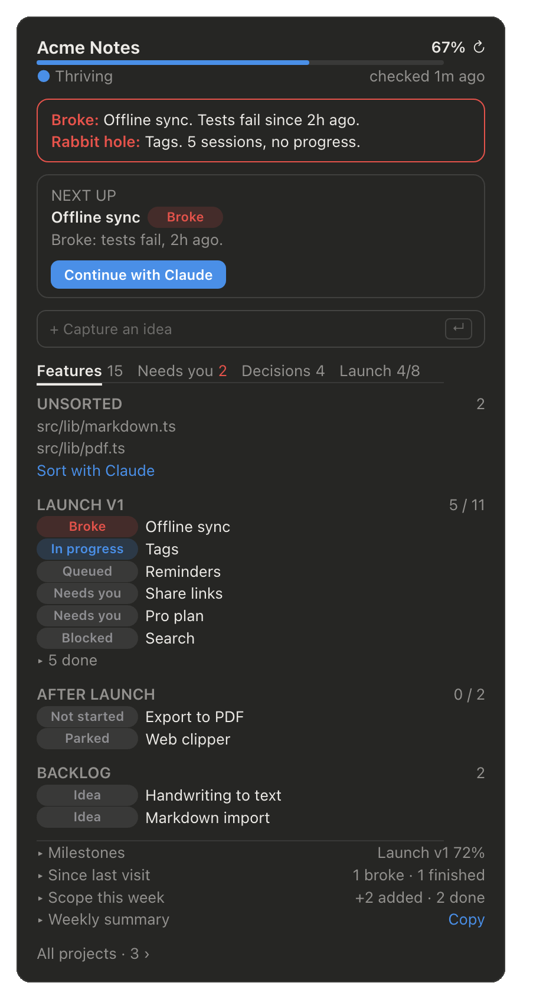
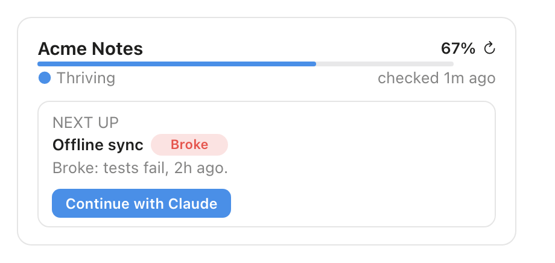
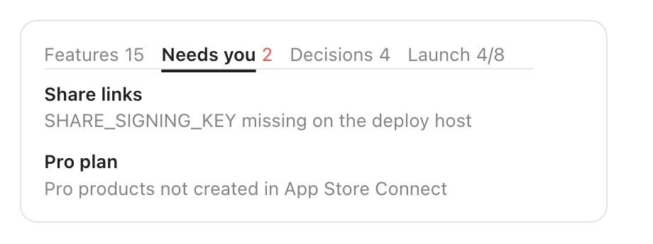
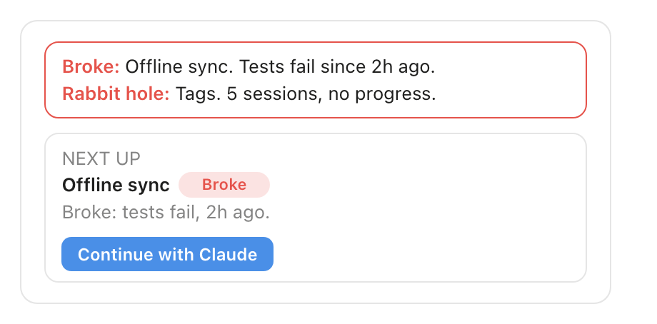
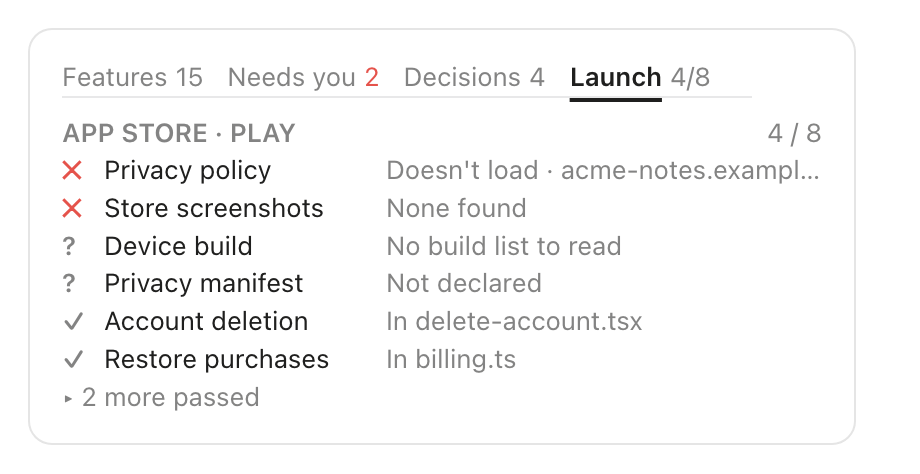
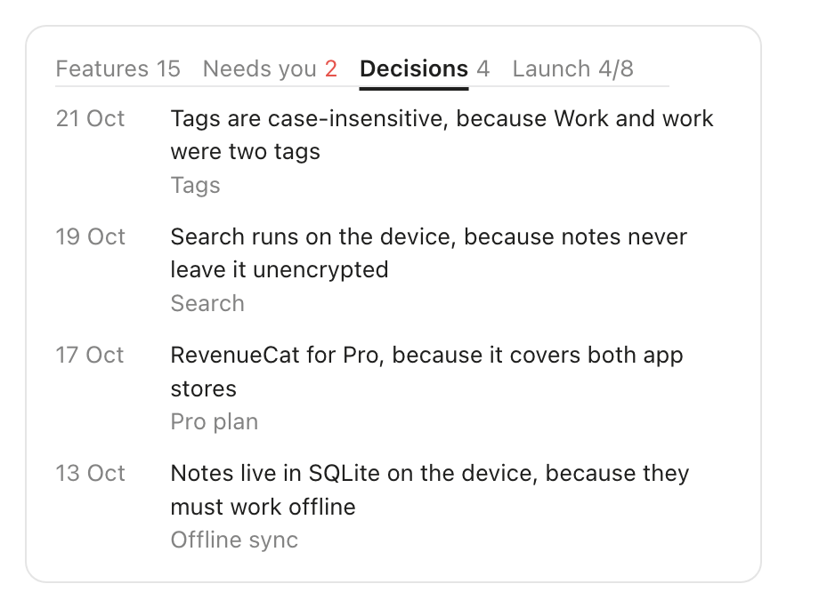
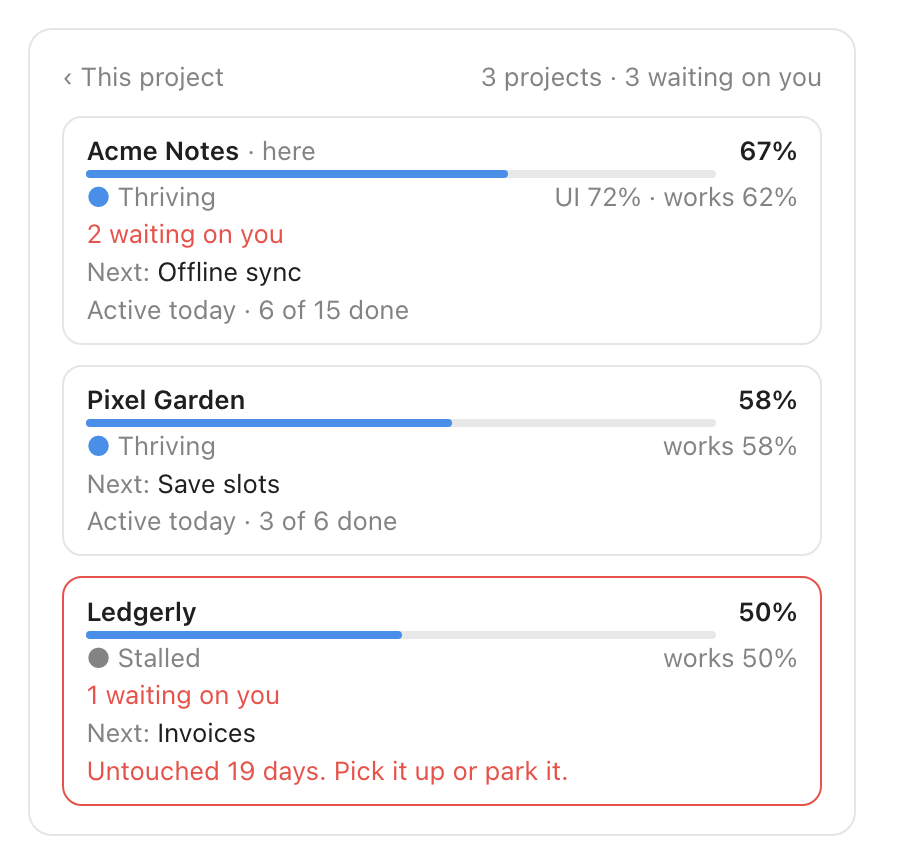

<div align="center">

<picture>
  <source media="(prefers-color-scheme: dark)" srcset="docs/media/wordmark-dark.png">
  
</picture>

**For when you open a project and think… now what?**

[](LICENSE)
[](https://code.claude.com/docs/en/plugins/mods/overview)
[](.claude-plugin/plugin.json)



</div>

## Install

In Claude Code:

```
/plugin install nowhat --marketplace symow07/noWhat
```

Then open a project and run `/nowhat`. Claude groups the code into features once; after that the sidebar keeps itself current.

## Why

You build fast with AI, across many projects at once.
A week later you open one and can't tell what's done, what's parked, or what's blocked on a key you never set.
noWhat works it out from the code and shows you, in one sidebar, the next thing to do.

## Features

### Next up

The one thing to work on now, with its last note and a button to hand it to Claude. Something that broke always comes first.

<picture>
  <source media="(prefers-color-scheme: dark)" srcset="docs/media/next-up-dark.png">
  
</picture>

### Needs you vs Needs code

Blockers only you can clear (an env var, an account, a store setting) get their own tab, with the exact thing missing. Blockers more code can clear stay in the feature list as *Blocked*.

<picture>
  <source media="(prefers-color-scheme: dark)" srcset="docs/media/needs-you-dark.png">
  
</picture>

### Regression alert

A feature that was working and isn't any more (its tests fail, or a file came unwired) shows a red strip until it works again. So does a rabbit hole: four or more sessions on one feature with nothing changing.

<picture>
  <source media="(prefers-color-scheme: dark)" srcset="docs/media/regression-dark.png">
  
</picture>

### Launch checklist

The usual reasons a store or reviewer turns a release back, checked from the repository: privacy policy, account deletion, a device build, Sign in with Apple, restore purchases, permission text. Web apps get their own list.

<picture>
  <source media="(prefers-color-scheme: dark)" srcset="docs/media/launch-dark.png">
  
</picture>

### Decision log

One line per key choice and why, recorded by Claude as it works. The answer to "why did we do it this way?" three weeks later.

<picture>
  <source media="(prefers-color-scheme: dark)" srcset="docs/media/decisions-dark.png">
  
</picture>

### All projects

One card per project: health, progress, what waits on you, what's next. A project untouched for two weeks says so.

<picture>
  <source media="(prefers-color-scheme: dark)" srcset="docs/media/all-projects-dark.png">
  
</picture>

Also: quick capture for ideas, *Since last visit*, a scope meter (features added against finished this week), a five-line weekly summary to copy, and pinning a feature's status by hand.

## How it works

Claude does one thing code can't: deciding which files make up which feature. Everything after that is evidence the plugin gathers itself, with git, the file system and your host's CLI:

- **Code:** do the feature's files exist, and does anything import them?
- **Git:** what changed, when, and which new files no feature claims yet (*Unsorted*)
- **Tests:** which test files belong to the feature, and whether they last passed
- **Config:** env var names the feature needs, checked against Railway, EAS, Vercel, Fly or Netlify. Names only
- **Live:** does your deployed app answer?

Fixed rules turn that into states. *Working* needs proof (tests, Claude ran it, or you said so), and unknown never downgrades anything.

These checks cost **zero tokens**. They run when the sidebar opens, every 5 minutes while it shows, and within 30 seconds of a commit, including commits from Codex or another editor. Only three buttons spend tokens: *Set up with Claude*, *Continue with Claude* and *Sort with Claude*.

The full detail: [docs/how-it-works.md](docs/how-it-works.md).

## Privacy

- **Runs only where you turn it on.** Nothing happens in a project until you run `/nowhat` in it. A `.claude/nowhat.json` someone else committed doesn't switch anything on.
- **Reads:** the project's files and git history, your test output, the env var **names** your deploy host lists, and your deployed app's URL.
- **Never stores or sends env values.** Host CLIs print values next to names; noWhat reads past them and keeps only names. Nothing reaches the model but names.
- **Writes only:** `.claude/nowhat.json` and `.claude/nowhat/` in the project, and `~/.claude/nowhat-projects.json`. Nothing outside the project you run it in.
- **No telemetry.** The only network requests go to your own deployed app and privacy-policy URL.

## Configuration

| Setting | Default | What it does |
| :- | :- | :- |
| `run_tests` | on | Lets setup run the project's test commands (10-minute cap, `CI=1`) |
| `check_hosts` | on | Lets noWhat ask your host's CLI which env var names are set |

Change them with `/plugin configure nowhat`.

| File | What | Commit it? |
| :- | :- | :- |
| `.claude/nowhat.json` | Features, states, notes, decisions, history | Your choice: it's readable and diffs cleanly |
| `.claude/nowhat/` | Derived evidence | No: add it to `.gitignore` |

## Try it on a demo

```
node docs/demo/make-demo.mjs
```

This builds *Acme Notes*, a made-up project with a regression, two blockers, a parked feature and two unsorted files, in `~/noWhat-demo/acme-notes`. Open that folder in Claude Code and run `/nowhat`.

## FAQ

**How many tokens does it use?**
The checks use none. The standing rules (about 450 tokens) are fixed text, so the prompt cache keeps them, and a one-line status (about 70 tokens) rides along with a prompt only when something changed.

**Does it work with Codex, Cursor or a plain editor?**
Yes. Detection reads git, not Claude's memory. New files show as *Unsorted*; *Sort with Claude* files them and catches up on the commits.

**Which stacks?**
Any. Tests are read for JS/TS (bun, npm, pnpm, yarn), pytest, Go, Rust, RSpec, Elixir, Swift, Dart/Flutter, Maven, Gradle and PHPUnit. Screens are recognised for Next.js, Expo Router, SvelteKit, Nuxt, Astro and Remix.

**Is there a keyboard shortcut?**
A plugin can't bind one, so `/nowhat` toggles the sidebar. In the terminal, `Ctrl+X Tab` focuses it and `Ctrl+X X` closes it.

**Does it work in the terminal?**
Yes, the same layout in text. It also works in the Code tab of the Claude desktop app.

**How do I take a project off the all-projects list?**
Remove its entry from `~/.claude/nowhat-projects.json`.

## Contributing

Issues and pull requests are welcome. See [CONTRIBUTING.md](CONTRIBUTING.md): how to run it from a local folder, the tests, and the one rule for test data (fixtures only, never a real project).

## License

[MIT](LICENSE)
